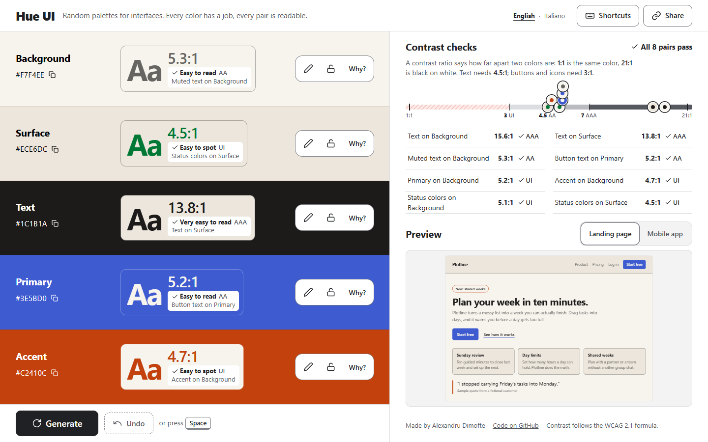
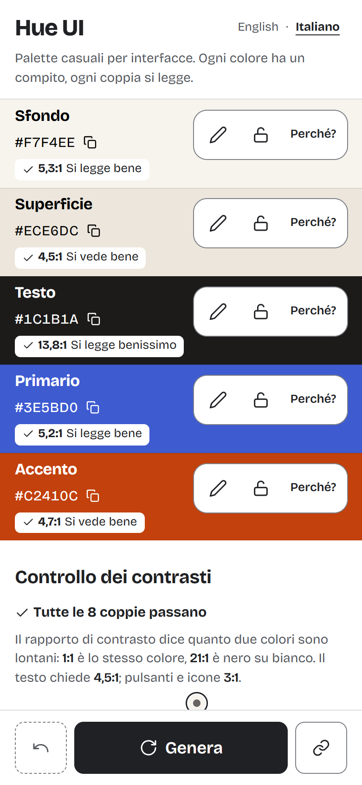

# Hue UI

[](https://github.com/AlexandruD18/hue-ui/actions/workflows/ci.yml)
[](https://github.com/AlexandruD18/hue-ui/actions/workflows/deploy.yml)
[](LICENSE)

**Random color palettes for interfaces. Every color has a job, every pair is readable.**

**[Try it live →](https://alexandrud18.github.io/hue-ui/)**



Most palette generators give you five colors in a row and leave the hard part to you. Which one is the background? Which one is the button? Will the text actually be readable? Hue UI answers those questions inside the generator. Every color gets a role, every text pair passes WCAG 2.1 contrast, and you see the palette on a real landing page and a mobile app straight away.

Designed and built end to end by Alexandru Mihai Dimofte, from research to Figma to production code.

## What you can do

- **Generate** a palette with the button or the Space bar. Lock the colors you like and keep going. Undo goes back 20 steps.
- **Read contrast as a proof, not a number.** Each band writes "Aa" in the real colors of its weakest pair, with the ratio and a plain verdict: "Easy to read", "Hard to spot".
- **Ask "Why?"** on any color or pair. You get the reason in one sentence, and when a pair fails, the exact fix ("darken Text to #707070, 4.5:1") applied in one click.
- **Type your own HEX.** The other colors adapt so every pair stays readable, changing only lightness, never hue.
- **Preview** the palette on a landing page and a mobile app, and enlarge either one to full size.
- **Share** a palette with a link, use keyboard shortcuts (or turn them off), switch between English and Italian.

<p align="center">
  
</p>

## Design process

1. **Research and planning.** Project charter with measurable goals, a review of five competing tools (Coolors, Adobe Color, Realtime Colors, Huemint, Leonardo), page structure with every line of copy, a PRD with 27 user stories, and a technical spec.
2. **Three design directions** with the same content: a paint-chip fan deck, contrast proof bands, and a pro "studio" layout. I chose the proof bands, because it's the only one that shows what makes Hue UI different at a glance. → [`design/direzioni/`](design/direzioni/)
3. **Critique before Figma.** An independent review found 36 issues in the prototype, the worst being a mobile layout where the five colors never fit on screen together. All fixed before moving on. → [`design/critica.md`](design/critica.md)
4. **Figma file** with variables for every role (four modes, including a deliberately broken palette), real components, desktop and mobile screens in both languages, and a clickable prototype. → [Open in Figma](https://www.figma.com/design/Vt2oN8Vcv3jzyvPY1PCWNj)
5. **Build in three sprints**, one issue per story, small pull requests, CI required before every merge.
6. **Pre-release reviews.** A visual QA pass and a cognitive walkthrough with Nielsen's heuristics, then fixes. → [`docs/revisioni/`](docs/revisioni/)

**Case study:** the full story, including what broke and how I fixed it, is in [`docs/05 - Caso di studio.md`](docs/05%20-%20Caso%20di%20studio.md), or as a [designed PDF](https://github.com/AlexandruD18/hue-ui/releases/download/v1.0.2/hue-ui-caso-di-studio.pdf). It's written in Italian.

## Under the hood

- **OKLCH color engine.** Palettes are generated in OKLCH, where perceived lightness is separate from hue and chroma. That's what lets the engine fix a contrast problem by moving only lightness, so a blue stays blue.
- **WCAG 2.1 contrast, never rounded up.** Ratios are truncated to one decimal, so 4.49 never shows as 4.5.
- **No backend.** Palette and language live in the URL, so every link is already a share link.
- **React 19, TypeScript strict, Vite.** Plain CSS ported straight from the design system, no UI library.

### Quality

| Check                                   | Result                                                             |
| --------------------------------------- | ------------------------------------------------------------------ |
| Lighthouse, desktop (live site)         | 100 Performance · 100 Accessibility · 100 Best Practices · 100 SEO |
| Lighthouse, mobile (live site)          | 99 Performance · 100 on the others                                 |
| JavaScript shipped                      | about 84 KB gzipped, budget 100 KB                                 |
| Unit and component tests                | 51 tests, 98% line coverage                                        |
| End-to-end tests with axe (WCAG 2.1 AA) | 10 tests at 1440 and 390 px, in English and Italian                |

The engine also has a property test. It runs 3,000 random palettes, each with one color pinned to a random value, and every contrast rule has to hold. That test is how I found a bug: a light accent typed by hand could push the background to a mid grey where no text was readable. The fix and the before/after screenshots are in the case study.

Every pull request has to pass lint, types, tests with coverage, end-to-end accessibility, Lighthouse and a link check before it can merge.

### Honest limits

There was no testing with real users. Beginner usability was checked with a cognitive walkthrough instead: the core task, "generate, lock the primary color, check the contrast", takes 2 clicks with no severe issues. That's evidence, not proof, and testing with five real people would be the next step.

## Run it locally

You need Node.js 22 and npm 11.

```bash
npm install
npm run dev        # http://localhost:5173/hue-ui/
```

| Command            | What it does                                     |
| ------------------ | ------------------------------------------------ |
| `npm run build`    | Type check and production build in `dist/`       |
| `npm run preview`  | Serve the build on http://localhost:4173/hue-ui/ |
| `npm test`         | Unit and component tests (Vitest)                |
| `npm run test:e2e` | End-to-end tests with axe (Playwright)           |
| `npm run lint`     | ESLint with strict TypeScript and jsx-a11y rules |
| `npm run lhci`     | Lighthouse CI with the performance budget        |

For end-to-end tests, run `npx playwright install chromium` once.

## Repository map

```
src/
├── color/        OKLCH conversions, WCAG contrast, generator, derived roles, fixes
├── state/        reducer, URL read and write
├── i18n/         English and Italian dictionaries
├── components/   bands, proof tile, contrast checks, Why? panel, dialogs, toasts
├── previews/     landing page and mobile app mockups
└── styles/       design tokens and styles
tests/e2e/        end-to-end flows with axe
design/           brief, three directions, design system, prototype, critique
docs/             charter, research, structure and copy, PRD, tech spec, reviews, case study
```

The interface and this README are in English. Project documents in `docs/` and `design/`, code comments and commit messages are in Italian.

## License

[MIT](LICENSE) · Changes are listed in the [CHANGELOG](CHANGELOG.md).
