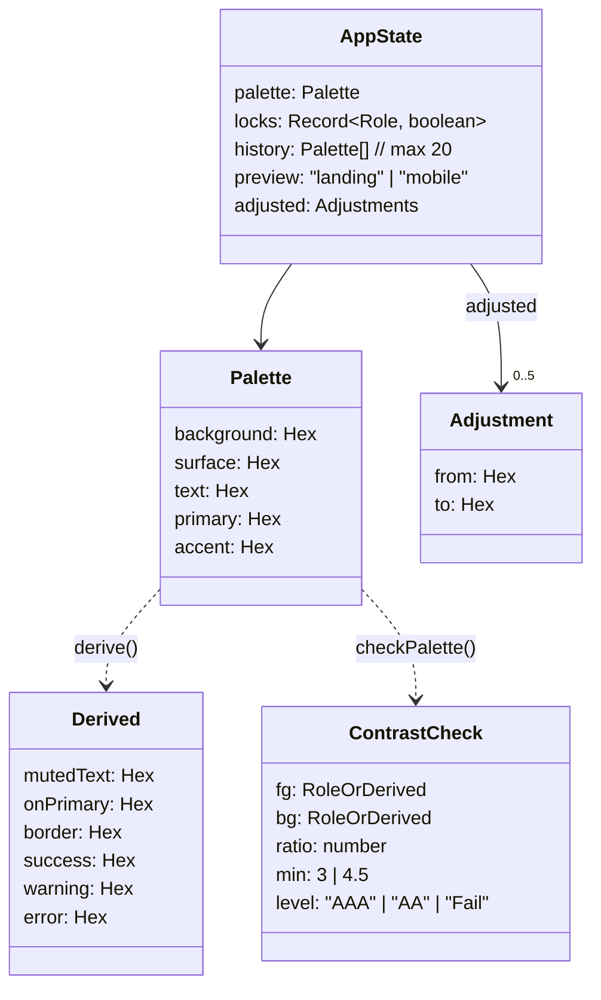
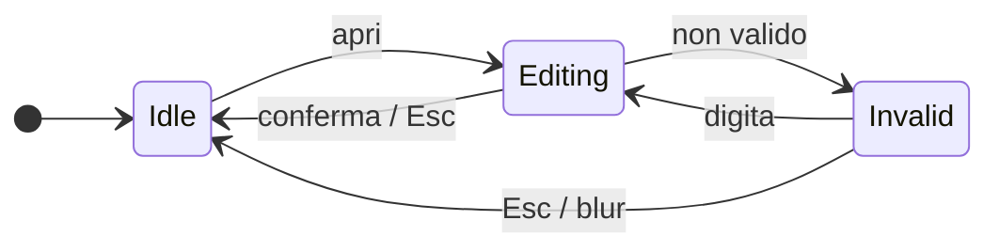

# 04 - Specifiche tecniche

**Data:** 12 novembre 2026
**Stato:** bozza da approvare
**Documenti collegati:** `03 - PRD.md`, `02 - Struttura e testi.md`

## 1. Situazione attuale

Non c'è nulla da migrare: niente sito, niente dati, niente utenti. Costi di esercizio previsti: zero (GitHub Pages e GitHub Actions gratuiti per repository pubblici).

## 2. Proposta

| Area | Scelta | Perché | Alternative scartate |
|------|--------|--------|----------------------|
| Framework | React con TypeScript `strict` | Deciso nel charter; il più richiesto nelle offerte | Vanilla, Svelte (vedi charter) |
| Build | Vite | Avvio rapido, build statica pronta per Pages | Next.js: server e routing inutili per una pagina sola |
| Stato | `useReducer` + Context | Uno stato piccolo e ben definito; il reducer è una funzione pura testabile | Redux, Zustand: dipendenze in più senza vantaggi a questa scala |
| Colore | Libreria interna (`src/color/`) | Poche funzioni (OKLCH ↔ sRGB, contrasto, gamut); peso minimo; mostra competenza nel portfolio | culori: ottima, ma pesa più del necessario a runtime. La usiamo **solo nei test** come riferimento per i valori |
| Stile | CSS Modules + variabili CSS | Le variabili sono già il modello dei ruoli; nessuna libreria da imparare o caricare | Tailwind: le classi d'utilità non aiutano su colori che cambiano a runtime |
| Font | 2 file WOFF2 in locale, `font-display: swap` | Privacy (nessuna chiamata a Google) e budget | Font di sistema: meno carattere |
| Icone | SVG inline, una sola famiglia (decisa nel design) | Nessuna richiesta in più, colorabili con `currentColor` | Font di icone: problemi di accessibilità |
| Test | Vitest, Testing Library, vitest-axe; Playwright con @axe-core/playwright per un flusso completo | Copertura dalla logica al browser vero | Jest: più lento con Vite |
| Qualità | ESLint (con jsx-a11y), Prettier (`tabWidth: 4`), `tsc --noEmit` | Regole del CLAUDE.md globale | |
| CI/CD | GitHub Actions: lint, format, typecheck, test, build, Playwright, Lighthouse CI; deploy su Pages da `main` | Ogni merge è verificato e pubblicato | Vercel: deciso Pages nel charter |
| Lingue | Dizionari TypeScript (`src/i18n/en.ts`, `src/i18n/it.ts`) con chiavi tipizzate; `Intl.NumberFormat` per i rapporti | Due lingue e circa 90 testi non giustificano una libreria; il tipo delle chiavi impedisce che una lingua resti indietro | react-i18next, FormatJS: peso e configurazione inutili a questa scala |
| Analytics | Nessuno | Requisito di privacy del PRD; il sito non ha obiettivi di conversione | Plausible: inutile per un progetto da portfolio |

## 3. Modello dati

Non c'è un database: il modello vive nel browser.



- `Hex` è una stringa `#rrggbb` minuscola, sempre normalizzata.
- `Adjustments` è `Partial<Record<Role, Adjustment>>`: per ogni ruolo corretto dal generatore, il colore prima e dopo.
- `Derived` e `ContrastCheck` non si salvano: si ricalcolano da `Palette` a ogni cambio (memoizzati).
- **URL**: `?p=f7f4ee-ece6dc-1c1b1a-3e5bd0-c2410c` nell'ordine background, surface, text, primary, accent. I blocchi non vanno nell'URL: si condivide la palette, non lo stato di lavoro. A ogni cambio si aggiorna con `history.replaceState`, quindi il pulsante Indietro del browser non si riempie.
- **Persistenza**: nessuna oltre l'URL. La cronologia di Undo vive in memoria.

## 4. Macchine a stati

### Scheda colore



| Da | Evento | A | Effetto |
|----|--------|---|---------|
| Idle | clic sul campione, Invio | Editing | Campo aperto con il valore attuale selezionato |
| Editing | input valido | Editing | Anteprima del colore sul campione |
| Editing | Invio o blur, codice valido | Idle | `SET_COLOR`: colore scritto, `locked = true`, adattamento degli altri, voce in cronologia |
| Editing | Invio, codice non valido | Invalid | Messaggio "Use a hex code like #3E5BD0.", `aria-invalid="true"` |
| Editing / Invalid | Esc | Idle | Nessun cambio; focus sul campione |
| Invalid | blur | Idle | Come Esc: un codice non valido non si salva mai |

### Azioni del reducer

| Azione | Precondizione | Effetto |
|--------|---------------|---------|
| `GENERATE` | almeno un colore non bloccato | Nuova palette, la precedente in cronologia |
| `GENERATE` | tutti bloccati | Nessun cambio; segnala `allLocked` per il toast |
| `UNDO` | cronologia non vuota | Ripristina l'ultima palette |
| `TOGGLE_LOCK(role)` | — | Inverte il blocco |
| `SET_COLOR(role, hex)` | `hex` valido | Imposta, blocca, adatta gli altri, voce in cronologia |
| `APPLY_FIX(role)` | coppia in `Fail` | Sostituisce il colore con la correzione proposta, voce in cronologia |
| `SET_PREVIEW(view)` | — | Cambia mockup |
| `LOAD_FROM_URL(p)` | `p` valido | Imposta la palette, nessun blocco |

## 5. Logica critica: il generatore

Una funzione pura, deterministica a parità di seme:

```ts
generate(prev: Palette, locks: Locks, rng: () => number): { palette: Palette; adjusted: Adjustments }
```

Passi:

1. **Modo**: se Background è bloccato, chiaro o scuro si deduce dalla sua luminosità OKLCH (L ≥ 0,6 = chiaro); altrimenti si sceglie a caso, 50%.
2. **Background**: chiaro L 0,95–0,99, C 0–0,03; scuro L 0,14–0,22, C 0–0,04; tinta casuale.
3. **Surface**: tinta del background, L spostata di 0,03–0,06 (più chiara nel modo scuro, più scura o bianca nel chiaro).
4. **Text**: tinta del background, L 0,15–0,25 (chiaro) o 0,92–0,97 (scuro), C ≤ 0,03.
5. **Primary**: tinta casuale, C 0,12–0,20.
6. **Accent**: tinta del primary + uno scarto scelto a caso tra le armonie (±30° analoga, 180° complementare, ±120° triadica, 150°/210° complementare divisa), C 0,10–0,18.
7. **Vincoli**: per ogni coppia di § 3 dell'analisi, se non passa si cerca per bisezione la luminosità OKLCH più vicina all'originale che la fa passare, **solo sul colore non bloccato** della coppia. La tinta resta; la croma si riduce solo se il colore esce dal gamut sRGB.
8. **Ruoli ricavati**: Muted text, On primary, Border, stati, come in `02` § 3.
9. **Verifica finale**: `checkPalette`. Con colori tutti generati deve passare sempre; se due colori bloccati sono in conflitto, la coppia resta `Fail` e la correzione si propone nel Why?.

Ordine di risoluzione dei vincoli: Background → Surface → Text → Primary → Accent. Così ogni colore si adatta a quelli già fissati.

### Casi di test

| # | Caso | Atteso |
|---|------|--------|
| T1 | `contrast("#000000", "#ffffff")` | 21 |
| T2 | `contrast("#777777", "#ffffff")` | 4,48 (±0,01) |
| T3 | `contrast(a, b) === contrast(b, a)` | vero per 1.000 coppie casuali |
| T4 | `parseHex("#35d")`, `parseHex("3355DD")` | `"#3355dd"` |
| T5 | `parseHex("#12345")`, `parseHex("blue")` | `null` |
| T6 | `oklchToHex(hexToOklch(x))` | `x` per 10.000 colori sRGB casuali |
| T7 | Conversioni OKLCH | uguali a culori entro 0,001 su 1.000 colori |
| T8 | `generate` con 10.000 semi, nessun blocco | 0 coppie sotto soglia |
| T9 | `generate` con 10.000 semi, blocchi casuali su palette valide | 0 coppie sotto soglia; colori bloccati identici |
| T10 | `generate` con tutti i colori bloccati | palette identica |
| T11 | Stesso seme, stessi blocchi | stessa palette (determinismo) |
| T12 | Modo su 1.000 semi | tra il 35% e il 65% scuro |
| T13 | `derive`: Muted text | ≥ 4,5:1 su background e surface |
| T14 | `suggestFix` su coppia in conflitto | colore con stessa tinta che passa |
| T15 | URL `?p=` valido / con 4 codici / con codice rotto | palette / `null` / `null` |

## 5b. Lingue

- **Scelta della lingua**, in ordine: parametro `?lang=it|en` nell'URL, poi `navigator.languages` (la prima che inizia con `it` dà l'italiano), poi inglese. La scelta fatta con il selettore aggiorna l'URL con `history.replaceState` insieme a `?p=` e si ricorda in `localStorage` (con try/catch: se non c'è, vale il browser).
- **Dizionari**: `en.ts` è la fonte; `it.ts` ha lo stesso tipo (`satisfies Messages`), quindi una chiave mancante è un errore di compilazione. I testi con valori usano funzioni: ``copied: (hex) => `Copiato ${hex}` ``.
- **Numeri**: `formatRatio(r, locale)` tronca a un decimale e usa `Intl.NumberFormat` (`4.6:1` in inglese, `4,6:1` in italiano). I codici HEX non cambiano.
- **Pagina**: `<html lang>` cambia con la lingua; `title` e `meta description` dai dizionari; `<link rel="alternate" hreflang="en|it">` verso `?lang=en` e `?lang=it`, canonico sempre sulla home.
- **Cosa non si traduce**: i codici HEX, le sigle AA/AAA/UI, i tasti delle scorciatoie (L e C restano anche in italiano) e i mockup Plotline, che rappresentano il sito di qualcun altro e restano in inglese in entrambe le lingue.
- **Test**: ogni chiave presente in entrambe le lingue (anche a runtime, per sicurezza); `formatRatio` in entrambe le lingue; il selettore cambia `lang` e testi; Playwright apre `?lang=it` e controlla titolo e Generate ("Genera").

## 6. Permessi e migrazione

Non applicabile: nessun account, nessun dato sul server, nessun sito precedente da reindirizzare.

## 7. Sicurezza

- Nessun input arriva a un server. L'unico input esterno è `?p=`: si valida con una regex stretta (`^[0-9a-f]{6}(-[0-9a-f]{6}){4}$`) prima di usarlo e non finisce mai nel DOM come HTML.
- Content Security Policy con `<meta>`: `default-src 'self'; style-src 'self' 'unsafe-inline'` (necessario per le variabili CSS impostate a runtime); nessuno script esterno.
- Dependabot attivo; `npm audit` in CI senza vulnerabilità alte.

## 8. Accessibilità (dettagli tecnici)

- Generate è un `<button>`; Lock è un `<button aria-pressed>`; Why? è un `<button aria-expanded aria-controls>` con pannello non modale.
- Shortcuts usa `<dialog>` nativo con `showModal()`.
- Selettore di anteprima con pattern `tablist` ARIA.
- Regione `aria-live="polite"` unica per gli annunci; i toast la usano.
- **Anello di focus**: doppio contorno (interno scuro, esterno chiaro) per restare visibile su qualunque colore generato.
- L'interfaccia di Hue UI ha colori propri fissi: la palette generata colora **solo** campioni e mockup, mai i controlli. Così l'accessibilità dell'app non dipende dal caso.

## 9. Prestazioni

- Budget dell'analisi § 5, controllato da Lighthouse CI (`budget.json`) a ogni PR.
- Il cambio di palette aggiorna solo variabili CSS sull'elemento del mockup: nessun nuovo render dei componenti del mockup.
- Misura di O4: `performance.mark` prima del dispatch e dopo il frame successivo (`requestAnimationFrame`), registrata in un test Playwright.

## 10. Struttura del codice

```
src/
├── color/        oklch.ts, contrast.ts, hex.ts, generate.ts, derive.ts, fix.ts (+ .test.ts)
├── state/        reducer.ts, context.tsx, url.ts (+ .test.ts)
├── i18n/         en.ts, it.ts, index.ts (lingua, formatRatio) (+ .test.ts)
├── components/   Swatch, ContrastList, WhyPanel, Toolbar, ShortcutsDialog, Toast, PreviewTabs
├── previews/     LandingPreview, MobilePreview
├── styles/       tokens.css, global.css
└── main.tsx
tests/e2e/        flow.spec.ts
```

## 11. Piano di test e monitoraggio

| Livello | Cosa | Strumento |
|---------|------|-----------|
| Unità | `src/color`, `src/state` (T1–T15) | Vitest, copertura ≥ 90% |
| Componenti | Lock, edit HEX, Why?, dialog, toast | Testing Library + vitest-axe |
| Flusso | Copione della demo del PRD | Playwright + axe |
| Qualità | Lighthouse mobile e desktop | Lighthouse CI con soglie del PRD |
| Visivo | Layout 390 e 1440, prima di ogni release | Agente separato con chrome-devtools, rapporto in `docs/revisioni/` |

Monitoraggio: nessuno a runtime (niente analytics per scelta). Gli errori si cercano con il controllo visivo prima di ogni release.
