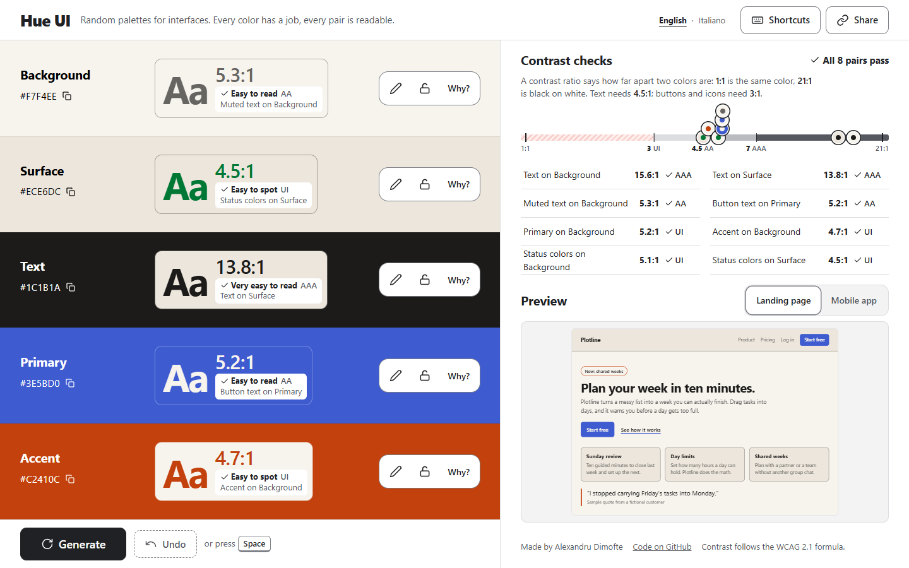
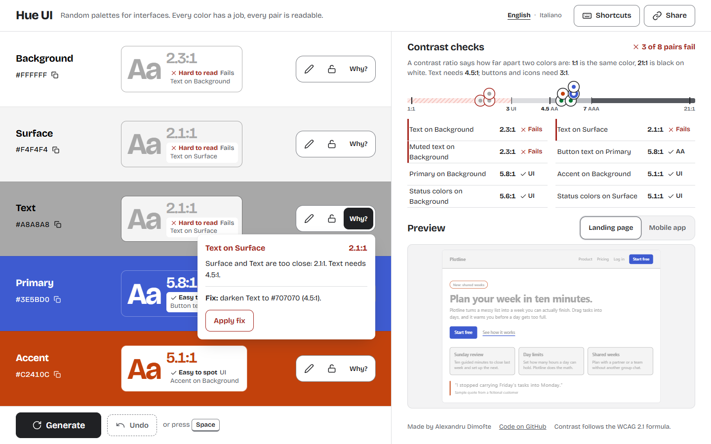
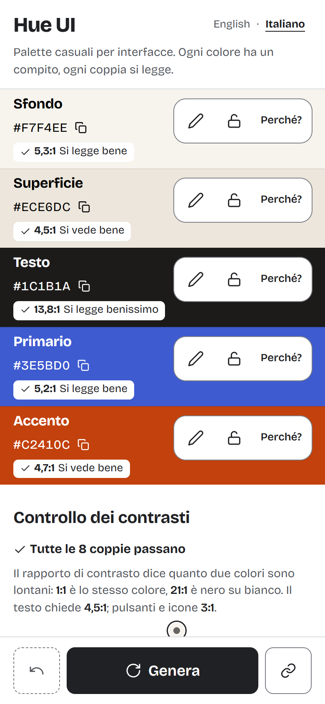
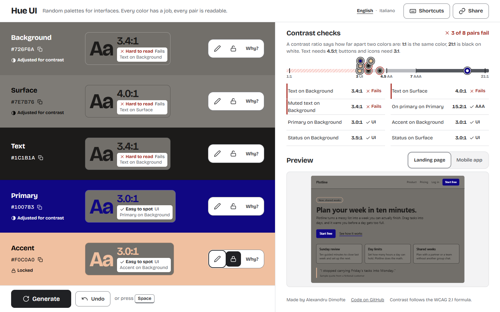
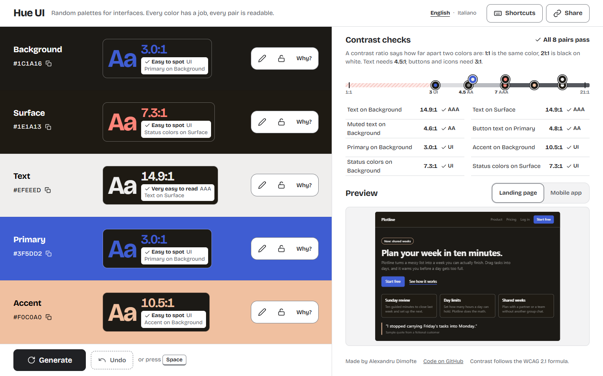

# Caso di studio

**Progetto:** Hue UI
**Autore:** Alexandru Mihai Dimofte
**Data:** 14 novembre 2026
**Stato:** versione 1.0 pubblicata

Hue UI è un generatore di palette per chi disegna interfacce. Dà a ogni colore un compito e controlla che ogni testo si legga. Questo documento racconta come ci sono arrivato, quali scelte ho fatto e cosa non ha funzionato al primo colpo.

- **Sito:** https://alexandrud18.github.io/hue-ui/
- **Codice:** https://github.com/AlexandruD18/hue-ui
- **Design:** file Figma con design system, schermate desktop e mobile, prototipo e copertina

## Il problema

I generatori di palette più usati, Coolors in testa, mettono cinque colori in fila e lasciano a te il resto. Il passo successivo è il più difficile, soprattutto per chi comincia: decidere quale colore fa da sfondo, quale da testo, quale dal pulsante. Poi bisogna controllare che il testo si legga davvero. Il controllo dei contrasti di solito sta in un altro strumento e parla per sigle: 4.5:1, AA, AAA.

Ho scelto due tipi di persona:

- lo studente di design, che sa cos'è una palette ma non cosa vuol dire 4.5:1;
- il designer che lavora, che vuole una palette pronta da provare su un'interfaccia senza aprire tre strumenti.

## L'idea in una frase

Il contrasto non si dichiara, si dimostra. Ogni ruolo è una fascia piena di colore. Dentro c'è una tessera che scrive "Aa" e il rapporto con i colori veri della coppia più debole. Se il numero si legge, la coppia funziona. Lo vedi prima ancora di sapere cosa vuol dire "AA".

<figure>

<figcaption>La pagina a 1440 × 900. Le cinque fasce, gli 8 controlli e l'anteprima stanno in una schermata, senza scroll.</figcaption>
</figure>

## Come ho lavorato

Ho seguito lo stesso processo per tutto il progetto. Prima i documenti, poi il design, poi il codice. Alla fine i controlli li ha fatti un agente separato, che non aveva costruito niente.

1. **Pre-progetto.** Charter con obiettivi misurabili, analisi di cinque concorrenti, struttura della pagina con tutti i testi, PRD con 27 user story e criteri di accettazione, specifiche tecniche.
2. **Tre direzioni di design**, con gli stessi contenuti e gli stessi testi: Chip, una mazzetta di campioni di vernice; Prova, le fasce con la tessera "Aa"; Studio, un'impostazione da strumento professionale. Ho scelto Prova, l'unica che mostra a colpo d'occhio la differenza dai concorrenti.
3. **Critica.** Una revisione separata ha trovato 36 problemi nel prototipo. Il più grave: su mobile la palette era una colonna di circa 1600 px e i cinque colori non si vedevano mai insieme. Li ho corretti prima di passare a Figma.
4. **Figma.** Variabili per i ruoli, con quattro modi (tre palette e un caso in conflitto), componenti veri, schermate desktop e mobile in inglese e in italiano, prototipo cliccabile.
5. **Sviluppo in tre sprint.** Issue per ogni storia, un branch e una pull request per ogni blocco di lavoro, CI obbligatoria prima del merge.
6. **Revisioni finali.** Controllo visivo e cognitive walkthrough, poi correzioni, poi la release.

## Scelte che difendo

**Una sola interfaccia.** All'inizio avevo pensato a due modi, Principiante e Pro. Li ho tolti. Due modi raddoppiano i testi, i test e le decisioni per chi arriva, e la legge di Hick va contro. Una pagina sola, con le spiegazioni a richiesta dietro "Why?", serve tutti e due.

**Cinque colori, il resto ricavato.** Sfondo, superficie, testo, primario e accento li sceglie il generatore o li blocchi tu. Testo secondario, testo sui pulsanti, bordo e colori di stato li ricava il motore e li controlla allo stesso modo. Più colori liberi avrebbero voluto dire più coppie da far tornare.

**I numeri spiegati a parole.** Ogni rapporto ha accanto un giudizio: "Easy to read", "Hard to spot". Sopra il righello c'è una frase che dà le ancore: 1:1 è lo stesso colore, 21:1 è nero su bianco. Il testo chiede 4,5:1, pulsanti e icone 3:1.

**Una correzione, non solo un errore.** Quando una coppia non passa, "Why?" dice quale colore spostare, di quanto e con quale risultato, e lo applica con un clic. Cambia solo la luminosità e la tinta resta quella. È l'idea che ho preso da Adobe Color e portato dentro il generatore.

<figure>

<figcaption>Una palette che non passa. Il pannello spiega il problema e propone la correzione esatta.</figcaption>
</figure>

**Desktop senza scroll, mobile progettato a parte.** Su desktop tutto sta in 900 px di altezza. Su mobile le fasce diventano righe compatte, tutte e cinque nella prima schermata, e le azioni principali stanno in una barra in basso, sotto il pollice.

<figure>

<figcaption>A 390 px, in italiano. Le cinque fasce stanno nella prima schermata.</figcaption>
</figure>

## Sotto il cofano

- **Colore in OKLCH.** Il generatore lavora nello spazio OKLCH, dove la luminosità percepita è separata da tinta e saturazione. Così può correggere un contrasto spostando solo la luminosità, senza che il blu diventi viola.
- **Contrasto WCAG 2.1.** Formula ufficiale, rapporti troncati a un decimale. Un 4,49 non diventa mai 4,5 per arrotondamento.
- **React, Vite e TypeScript in modalità strict**, CSS semplice portato dal design system. Nessun server: palette e lingua stanno nell'URL, quindi un link è già una condivisione.
- **Qualità come regola della CI.** Nessuna pull request entra senza lint, tipi, copertura dei test almeno al 90%, test end-to-end con axe a 1440 e 390 px, Lighthouse con Accessibility 100 e Performance almeno 95.

## Cosa si è rotto e come l'ho sistemato

Il controllo visivo prima della 1.0 ha trovato un problema bloccante che i miei test non vedevano.

Il caso: sul link condiviso scrivo a mano un Accento chiaro, `#F0C0A0`. Per dargli 3:1, il motore scuriva lo sfondo fino al primo grigio che bastava, `#726F6A`. Su quel grigio medio però né il nero né il bianco arrivano a 4,5:1, e la pagina diceva "3 of 8 pairs fail". Il generatore casuale non cadeva mai in questo caso. L'adattamento dopo una modifica a mano sì.

<figure>

<figcaption>Prima: lo sfondo si ferma su un grigio medio e tre coppie non passano.</figcaption>
</figure>

La correzione ha due parti.

- Sfondo e superficie si spostano solo verso una luminosità che lascia posto a un testo leggibile su entrambi.
- Quando devono cambiare lato non si fermano al limite: vanno dove stanno i fondi veri, e il testo diventa quasi bianco o quasi nero.

Lo stesso caso ora dà un tema scuro con il testo a 14,9:1 e 8 coppie su 8.

<figure>

<figcaption>Dopo: la stessa modifica produce un tema scuro leggibile.</figcaption>
</figure>

Prima di correggere ho scritto un test che riproduce il guasto. Poi ne ho aggiunto uno più largo: 3000 palette casuali, ognuna con un ruolo fissato a un colore qualsiasi. Tutti i vincoli devono passare. Il test falliva anche per altri ruoli, non solo per l'Accento, quindi il problema era più ampio di quello segnalato.

Il walkthrough ha trovato un'altra cosa che a me sembrava giusta. La pagina dice "or press Space". Dopo un clic sul lucchetto però il focus resta lì, e Spazio sbloccava il colore invece di generare. Ora conta come si è arrivati al pulsante. Dopo un clic, Spazio genera. Se ci si arriva con Tab, Spazio preme il pulsante, come in qualunque pagina.

## Risultati

| Misura | Obiettivo | Risultato |
| --- | --- | --- |
| Lighthouse desktop, sito pubblicato | Performance ≥ 95, Accessibility 100 | 100, 100, 100, 100 |
| Lighthouse mobile, sito pubblicato | | Performance 99, le altre 100 |
| Caricamento più grande (LCP) | | 0,3 s desktop, 1,2 s mobile |
| JavaScript compresso | ≤ 100 KB | circa 83 KB, di cui circa 58 di React |
| Test unitari | copertura ≥ 90% | 48 test, 98% delle righe |
| Test end-to-end con axe | 0 violazioni | 8 test, desktop e mobile, inglese e italiano |
| O2: un principiante crea una palette da solo | ≤ 3 clic, 0 problemi gravi | 2 clic, 0 problemi gravi (walkthrough, non utenti veri) |

## Limiti dichiarati

- **Nessun test con persone vere.** Per l'obiettivo O2 ho usato un cognitive walkthrough e una valutazione euristica fatti da un valutatore separato. È un metodo riconosciuto, ma non sostituisce cinque persone davanti allo schermo. È la prima cosa che farei con più tempo.
- **Alcune rifiniture rimandate alla 1.0.1.** Tra queste, l'anteprima dell'app mobile poco leggibile su desktop e le etichette visibili per i pulsanti a icona su mobile. Sono elencate nell'issue #41.
- **L'anteprima resta in inglese** anche nell'interfaccia italiana: è il sito di un prodotto immaginario, non parte dell'interfaccia.

## Cosa mi porto via

Il test che conta è quello sul percorso che non hai previsto. Il generatore lo avevo provato su 200.000 palette senza un errore. Il guasto stava in un percorso vicino, la modifica a mano, che usa la stessa funzione con un colore fisso e arriva dove il caso non arriva mai. Da qui in avanti, ogni volta che un input passa da "scelto dal programma" a "scritto dall'utente", scrivo un test a proprietà sull'input dell'utente, non solo sul caso felice.
